# DOKUMEN SYSTEM DESIGN — DIGITAL GUARDIAN
**Tema:** *"Guardians of the Digital Space — Empowering Today's Generation."*  
**Pendekatan Frontend & UI:** React 18 (TypeScript + Vite) dengan Minimalist *"Software"* Design System (`frontend-design` Skill)  
**Peran Perancang:** Senior Software Architect, System Analyst, & Software Engineer  

---

## PENDAHULUAN DAN GAMBARAN UMUM SISTEM

**Digital Guardian** adalah platform pembelajaran keamanan siber interaktif berbasis web (*Single-Page Application* menggunakan **React**) yang dirancang untuk melatih generasi muda Indonesia dalam mengenali, menganalisis, dan merespons berbagai ancaman penipuan digital (*digital scam*), *phishing*, dan rekayasa sosial (*social engineering*).

Berbeda dengan portal artikel pasif, Digital Guardian menempatkan pengguna (*Pemain*) di dalam situasi pengambilan keputusan nyata secara aman melalui empat modul terintegrasi:
1. **Scam Simulator**: Simulasi percakapan interaktif bercabang (*branching narrative*) dengan karakter fiktif untuk melatih refleks keputusan saat menghadapi manipulasi psikologis, permintaan *One-Time Password* (OTP), file `.APK` berbahaya, atau tawaran kerja fiktif.
2. **Scam Detective**: Modul investigasi kasus berbasis bukti (*evidence inspection*) di mana pemain mengidentifikasi indikator risiko (*red flags*) dari pesan, profil pengirim, klaim, dan tautan fiktif.
3. **Action Guide**: Panduan tanggap insiden (*incident response guide*) kontekstual berdasarkan 4 tahapan kritis paparan risiko.
4. **Guardian Profile**: Evaluasi hasil sesi pembelajaran secara deterministik yang merangkum skor, keputusan berisiko, indikator risiko yang terlewat, dan rekomendasi latihan ulang.

Secara visual dan antarmuka, sistem mengadopsi **Minimalist "Software" Design System** sesuai prinsip `frontend-design`: menggunakan permukaan terang yang bersih (`#fcfcfd`), tipografi tegas tanpa dekorasi berlebihan (`Host Grotesk` & `Instrument Sans`), warna aksi *electric-blue* (`#074ce0`) yang disiplin, serta transisi *continuous dark field* (`#16191f`) khusus pada area fokus simulasi dan ringkasan akhir.

---

## BAGIAN 1 — ANALISIS KEBUTUHAN DAN RUANG LINGKUP

### 1.1 Masalah Utama yang Ingin Diselesaikan
Generasi muda Indonesia memiliki tingkat penetrasi internet yang tinggi, namun masih rentan terhadap rekayasa sosial karena:
1. **Kesulitan Mengenali Indikator Penipuan**: Tidak menyadari tanda-tanda pesan penipuan (*urgency manipulation*, *typosquatting domain*, nomor tidak resmi).
2. **Mudah Terpikat Tawaran Manipulatif**: Mudah percaya pada undian hadiah, komisi tugas paruh waktu, investasi instan, atau kurir paket berformat `.apk`.
3. **Kurangnya Pemahaman Risiko Kredensial**: Belum memahami bahaya fatal membagikan kode OTP, PIN, *password*, atau izin baca SMS aplikasi.
4. **Kebingungan Saat Menerima Pesan Mencurigakan**: Tidak tahu cara memverifikasi kebenaran informasi melalui kanal independen.
5. **Kepanikan Pasca-Insiden**: Tidak mengetahui langkah mitigasi darurat ketika terlanjur mengeklik tautan *phishing*, menyerahkan OTP, atau mentransfer dana.

### 1.2 Tujuan Sistem
1. Menyediakan lingkungan simulasi tanpa risiko (*safe sandbox*) untuk melatih pengambilan keputusan menghadapi *scam*.
2. Melatih ketelitian analitis pengguna dalam membedakan pesan aman dan pesan berbahaya berdasarkan indikator risiko objektif.
3. Memberikan umpan balik (*feedback*) edukatif secara instan dan deterministik atas setiap pilihan tindakan.
4. Menyediakan panduan mitigasi darurat (*Action Guide*) yang terstruktur sesuai tingkat keterlanjuran pengguna.
5. Memberikan evaluasi sesi (*Guardian Profile*) yang transparan tanpa mengumpulkan data pribadi pengguna.

### 1.3 Aktor yang Terlibat
Pada ruang lingkup **MVP (Minimum Viable Product)**, sistem hanya memiliki **1 Aktor Utama**:
- **Pemain (Pengguna / Generasi Muda)**: Individu yang mengakses aplikasi web untuk menjalankan simulasi, melakukan investigasi kasus, membaca panduan tindakan, dan melihat evaluasi hasil sesi pembelajarannya.
- *Catatan Arsitektur Mengenai Aktor Lain*:
  - **Admin** *tidak dimasukkan* ke dalam MVP karena skenario dikelola secara terstruktur melalui kode/berkas JSON statis yang tervalidasi pada repositori (*Git-based content management*).
  - **AI Agent** dan **Database** bukan merupakan aktor eksternal, melainkan komponen internal implementasi (di mana AI tidak diwajibkan pada MVP).

### 1.4 Kebutuhan Bisnis (Business Requirements)
1. Aplikasi harus dapat langsung dimainkan (*zero-friction onboarding*) tanpa kewajiban registrasi atau *login* agar tingkat partisipasi pengguna maksimal.
2. Biaya operasional dan infrastruktur harus minimal namun memiliki ketersediaan tinggi dan dapat diakses melalui URL publik untuk keperluan demonstrasi, pengujian pengguna, dan penilaian juri.
3. Seluruh konten simulasi harus 100% fiktif dan bebas dari risiko hukum maupun penyalahgunaan (tidak memuat tautan berbahaya aktif).

### 1.5 Kebutuhan Pengguna (User Needs)
1. Antarmuka yang minimalis, cepat, bebas distraksi visual, dan nyaman dibaca di perangkat *mobile* maupun *desktop*.
2. Alur simulasi yang terasa nyata dengan pilihan respons yang masuk akal dan konsekuensi percakapan yang benar-benar berubah sesuai pilihan.
3. Penjelasan yang mudah dipahami (bukan jargon teknis yang rumit) mengenai *mengapa* suatu pilihan berbahaya atau aman.
4. Panduan langkah demi langkah yang langsung dapat dipraktikkan saat menghadapi situasi darurat penipuan.

### 1.6 Batasan dan Asumsi Sistem
#### Batasan Sistem (Constraints):
1. **Tanpa Registrasi/Login**: MVP tidak memiliki fitur pembuatan akun atau autentikasi.
2. **Akses Langsung**: Pengguna langsung berinteraksi dengan modul pembelajaran saat membuka aplikasi.
3. **Rule-Based Deterministik**: Skenario dan penilaian menggunakan aturan terstruktur (*deterministic rule engine*), bukan *probabilistic LLM* pada MVP.
4. **Sesi Sementara (Ephemeral Session)**: Progres disimpan selama sesi aktif di peramban (`React State` + `sessionStorage`) dan tidak membutuhkan pelacakan lintas perangkat.
5. **Data 100% Fiktif & Aman**: Dilarang meminta data pribadi nyata (OTP, *password*, nomor rekening) dan dilarang menggunakan domain *phishing* aktif atau file `.apk` sungguhan.
6. **Transparansi Edukasi**: Sistem wajib menyertakan *disclaimer* bahwa skor sesi adalah sarana edukasi, bukan jaminan mutlak bebas penipuan.

#### Asumsi Teknis & Dampaknya terhadap Desain:
| No | Asumsi Teknis | Dampak terhadap Desain Sistem |
| :--- | :--- | :--- |
| **A-01** | Jumlah skenario awal berkisar antara 5–15 skenario Simulator dan 5–15 kasus Detective dengan ukuran payload data < 200 KB. | Data skenario dapat dibundel sebagai modul JSON statis bertipe kuat (*strongly-typed TypeScript JSON*) atau disajikan melalui API ringan tanpa latensi query kompleks. |
| **A-02** | Pengguna mayoritas mengakses aplikasi melalui peramban ponsel pintar (Chrome Android / Safari iOS) dan laptop. | Desain komponen React wajib mengutamakan *responsive layout* (breakpoint `1050px`, `760px`, `480px`) dan target sentuh (*touch target*) minimal `44x44px`. |
| **A-03** | Pengguna mungkin tidak sengaja memuat ulang (*refresh*) halaman di tengah simulasi. | State sesi di React disinkronkan ke `window.sessionStorage` agar sesi yang sedang berjalan tidak hilang saat *page reload*, namun otomatis bersih saat tab ditutup. |

### 1.7 Pembagian Fitur MVP vs Pengembangan Berikutnya (MoSCoW Prioritization)

| Prioritas | Kode & Nama Fitur | Status Ruang Lingkup | Alasan Pemilihan |
| :--- | :--- | :--- | :--- |
| **Must Have** | **M-01**: Landing & Navigasi Mode Minimalis (*Software Design System*) | **MVP** | Pintu masuk utama aplikasi dan orientasi pengguna terhadap 4 modul. |
| **Must Have** | **M-02**: *Scam Simulator* dengan Percabangan Nyata (*True Branching Node*) | **MVP** | Fitur inti untuk melatih pengambilan keputusan interaktif dalam percakapan. |
| **Must Have** | **M-03**: *Deterministic Scoring & Immediate Feedback Engine* | **MVP** | Memberikan alasan edukatif dan konsekuensi langsung di setiap tahapan pilihan. |
| **Must Have** | **M-04**: *Scam Detective* (Inspeksi Bukti & Evaluasi Indikator Risiko) | **MVP** | Fitur inti untuk melatih analisis bukti dan mengenali *red flags* penipuan. |
| **Must Have** | **M-05**: *Action Guide* (Panduan 4 Situasi Tanggap Insiden) | **MVP** | Fitur krusial untuk mitigasi darurat sesuai kondisi pengguna. |
| **Must Have** | **M-06**: *Guardian Profile* (Ringkasan Skor Sesi, Kesalahan, & Rekomendasi) | **MVP** | Evaluasi akhir sesi pembelajaran dan umpan balik komprehensif. |
| **Must Have** | **M-07**: Reset / Pengulangan Sesi Baru & Validasi Input | **MVP** | Menjamin pengujian ulang tidak mencampur skor sesi lama dan bebas dari *invalid state*. |
| **Should Have** | **S-01**: Penyimpanan Sesi Sementara pada `sessionStorage` | **MVP** | Mencegah hilangnya progres saat pengguna tidak sengaja me-*refresh* halaman. |
| **Should Have** | **S-02**: Integrasi Rekomendasi *Action Guide* dari Hasil *Detective/Simulator* | **MVP** | Menghubungkan indikator risiko yang terlewat dengan langkah panduan yang relevan. |
| **Could Have** | **C-01**: Backend REST API + PostgreSQL untuk Pencatatan Analitik Anonim | **Opsional / Fase 2** | Berguna jika tim ingin menganalisis skenario mana yang paling sering menjebak pengguna secara agregat. |
| **Could Have** | **C-02**: *Admin CMS Dashboard* untuk CRUD Skenario secara Dinamis | **Ditunda (Post-MVP)** | Pada MVP, pengelolaan skenario melalui file JSON terstruktur jauh lebih cepat, aman, dan bebas *overhead* autentikasi. |
| **Could Have** | **C-03**: *AI Dynamic Dialogue & Custom Scam Message Analyzer* | **Ditunda (Post-MVP)** | Membutuhkan biaya API LLM, *rate limiting* ketat, dan moderasi keamanan agar hasil penilaian tetap konsisten. |
| **Could Have** | **C-04**: Akun Pengguna, *Leaderboard*, dan Lencana (*Badges*) Permanen | **Ditunda (Post-MVP)** | Bertentangan dengan batasan MVP tanpa login dan prinsip minimalisasi data. |

---

## BAGIAN 2 — FUNCTIONAL DAN NON-FUNCTIONAL REQUIREMENTS

### 2.1 Functional Requirements (Kebutuhan Fungsional)
Seluruh kebutuhan fungsional diselaraskan dengan spesifikasi referensi sistem (`FR-01` s.d. `FR-14`):

| ID | Kebutuhan Fungsional | Deskripsi | Prioritas | Kriteria Penerimaan (Acceptance Criteria - Dapat Diuji) |
| :--- | :--- | :--- | :--- | :--- |
| **FR-01** | Menampilkan Halaman Utama | Sistem menampilkan informasi singkat tentang Digital Guardian, pengantar visual (*hero diagram*), dan pilihan mode pembelajaran. | Must Have | 1. Halaman utama menampilkan judul, deskripsi singkat, dan navigasi ke *Scam Simulator*, *Scam Detective*, *Action Guide*, serta *Guardian Profile*.<br>2. Menampilkan *disclaimer* bahwa seluruh skenario bersifat fiktif. |
| **FR-02** | Memilih Mode dan Skenario | Pemain dapat memilih mode *Scam Simulator* atau *Scam Detective* serta memilih skenario/kasus fiktif yang tersedia. | Must Have | 1. Daftar skenario menampilkan judul, deskripsi singkat, kategori ancaman, dan tingkat kesulitan.<br>2. Saat skenario diklik, sistem memuat data skenario yang dipilih tanpa *error*. |
| **FR-03** | Membuat Sesi Pembelajaran | Sistem membuat sesi pembelajaran baru (`LEARNING_SESSION`) setiap kali pemain memulai sebuah skenario. | Must Have | 1. Sistem membangkitkan `session_id` unik dengan `status = IN_PROGRESS` dan skor awal terdefinisi.<br>2. Riwayat jawaban pada sesi aktif dimulai dari kondisi kosong (`[]`). |
| **FR-04** | Menampilkan Percakapan Simulasi | Sistem menampilkan pesan karakter fiktif secara bertahap dan daftar pilihan tindakan sesuai `SCENARIO_NODE` aktif. | Must Have | 1. Menampilkan identitas fiktif pengirim, isi pesan pada node saat ini, dan minimal 2 tombol pilihan tindakan.<br>2. Teks pesan tidak mengandung tautan berbahaya aktif. |
| **FR-05** | Memproses Pilihan Pemain | Sistem memproses `choice_id` yang dipilih pemain dan menentukan cabang percakapan (`next_node_id`) berikutnya. | Must Have | 1. Pilihan berbeda yang memiliki `next_node_id` berbeda harus membawa pemain ke pesan/node percakapan yang berbeda pula (*true branching*).<br>2. Jika `next_node_id` bernilai `null`, sistem menandai alur percakapan skenario selesai. |
| **FR-06** | Mengevaluasi Keputusan Simulasi | Sistem menilai keputusan pemain secara deterministik berdasarkan bobot skor (`score_delta`) dan tingkat risiko (`risk_level`) pada aturan pilihan. | Must Have | 1. Pilihan yang sama pada kondisi node yang sama selalu menghasilkan perubahan skor dan label tingkat risiko (`SAFE`, `RISKY`, `DANGEROUS`, `BEST`) yang identik.<br>2. Jawaban "Ya/Lanjut" pada konteks verifikasi resmi dinilai aman (kontekstual, bukan sekadar menghukum kata "Ya"). |
| **FR-07** | Menampilkan Feedback Keputusan | Sistem menampilkan penjelasan edukatif mengapa suatu keputusan dinilai aman atau berisiko beserta konsekuensi langsungnya. | Must Have | 1. Setelah pemain memilih tindakan, panel *feedback* langsung tampil memuat judul evaluasi, alasan analisis risiko, dan konsekuensi situasi.<br>2. Pemain dapat membaca *feedback* sebelum lanjut ke node berikutnya atau hasil akhir. |
| **FR-08** | Menampilkan Bukti Investigasi | Pada *Scam Detective*, sistem menampilkan informasi kasus, pesan, profil pengirim fiktif, klaim, atau bukti lain (`SCENARIO_EVIDENCE`) untuk diperiksa. | Must Have | 1. Seluruh bukti kasus ditampilkan dengan jelas (misal: metadata pengirim, isi pesan, URL pratinjau fiktif, lampiran fiktif).<br>2. Menampilkan daftar opsi indikator risiko (`RISK_INDICATOR`) yang dapat dipilih pemain. |
| **FR-09** | Mengevaluasi Indikator Risiko | Sistem membandingkan indikator risiko yang dipilih pemain dengan indikator target (`SCENARIO_INDICATOR`) pada kasus tersebut. | Must Have | 1. Sistem menghitung jumlah indikator yang **Tepat** (*True Positive*), **Tidak Tepat** (*False Positive*), dan **Terlewat** (*False Negative*).<br>2. Sistem menampilkan penjelasan bukti pendukung (`EVIDENCE_INDICATOR`) untuk setiap indikator target serta edukasi bahwa satu tanda mencurigakan perlu dilihat secara utuh. |
| **FR-10** | Menampilkan Action Guide | Sistem menyediakan panduan langkah penanganan berdasarkan 4 situasi kritis yang dipilih pemain atau berdasarkan temuan risiko. | Must Have | 1. Mendukung 4 situasi: (1) Baru menerima pesan mencurigakan, (2) Sudah mengeklik tautan, (3) Sudah memasukkan kata sandi/OTP, (4) Sudah melakukan transfer uang.<br>2. Menampilkan langkah mitigasi berurutan, rekomendasi kanal resmi, dan *disclaimer* bahwa pemulihan dana/akun tidak dijamin pasti berhasil. |
| **FR-11** | Menghitung Hasil Pembelajaran | Sistem menghitung skor akhir sesi dan merangkum performa pemain selama satu sesi (`SESSION_RESULT`). | Must Have | 1. Skor akhir dihitung secara deterministik pada rentang `0–100` berdasarkan akumulasi keputusan Simulator dan/atau ketepatan indikator Detective.<br>2. Menghasilkan daftar keputusan berisiko, indikator terlewat, dan kategori kemampuan yang sudah baik. |
| **FR-12** | Menampilkan Guardian Profile | Sistem menampilkan ringkasan evaluasi sesi (*Guardian Profile*) berisi skor, rincian ketepatan, indikator terlewat, dan rekomendasi latihan. | Must Have | 1. Menampilkan kartu metrik skor sesi, jumlah keputusan tepat, keputusan berisiko, dan indikator terlewat.<br>2. Menampilkan rekomendasi spesifik materi/*Action Guide* atau skenario yang perlu dipelajari kembali. |
| **FR-13** | Mengulang Skenario (Reset Sesi) | Pemain dapat mengulangi skenario atau mereset sesi menggunakan `LEARNING_SESSION` baru agar hasil percobaan tidak tercampur. | Must Have | 1. Menekan tombol "Ulangi Skenario" atau "Reset Sesi" membuat `session_id` baru dan mengembalikan node ke tahap awal.<br>2. Skor dan jawaban dari sesi sebelumnya tidak mencemari perhitungan sesi baru. |
| **FR-14** | Menangani Jawaban Tidak Valid | Sistem memvalidasi input pilihan pemain, mencegah pengiriman jawaban kosong/tidak sah, dan menampilkan pesan arah yang jelas. | Must Have | 1. Jika pemain menekan "Evaluasi Bukti" pada *Scam Detective* tanpa memilih satu pun indikator, sistem menolak pemrosesan dan menampilkan pesan instruktif.<br>2. Sistem menolak `choice_id` atau `indicator_id` yang bukan milik skenario yang sedang aktif. |

---

### 2.2 Non-Functional Requirements (Kebutuhan Non-Fungsional)
Disusun berdasarkan kategori standar rekayasa perangkat lunak dan diselaraskan dengan `NFR-01` s.d. `NFR-12`:

| ID | Kategori | Deskripsi Kebutuhan | Indikator / Metrik Pengujian (Target Desain) |
| :--- | :--- | :--- | :--- |
| **NFR-01** | **Usability** (Kemudahan Penggunaan) | Antarmuka mudah dipahami oleh generasi muda tanpa latar belakang teknis keamanan siber; menggunakan bahasa aktif dan jelas. | Pengguna baru dapat memulai simulasi maksimal dalam **2 klik** dari halaman utama tanpa membaca panduan eksternal. |
| **NFR-02** | **Compatibility & Responsiveness** | Tata letak beradaptasi secara mulus pada layar *desktop*, *tablet*, dan ponsel sesuai *breakpoint* sistem desain. | Tidak ada *horizontal overflow* pada lebar layar `360px` (Mobile), `760px` (Tablet), `1050px` (Compact Desktop), hingga `1440px+`. |
| **NFR-03** | **Performance** (Kinerja) | Transisi percabangan simulasi, evaluasi bukti, dan kalkulasi skor berjalan cepat tanpa jeda yang mengganggu fokus belajar. | Waktu respons pemrosesan pilihan lokal di React **< 100 ms** (target desain maksimal **≤ 2 detik** pada jaringan 4G normal). *First Contentful Paint* (FCP) target desain **≤ 1.5 detik**. |
| **NFR-04** | **Availability** (Ketersediaan) | Aplikasi dapat diakses kapan saja melalui URL publik untuk keperluan edukasi dan pengujian juri. | Target desain ketersediaan layanan hosting statis/CDN **≥ 99.5%** selama masa pengujian/kompetisi. |
| **NFR-05** | **Security** (Keamanan Aplikasi) | Seluruh input divalidasi ketat; terbebas dari kerentanan *Cross-Site Scripting* (XSS), injeksi konten, maupun tautan *phishing* sungguhan. | **0 penggunaan** `dangerouslySetInnerHTML` tanpa sanitasi; seluruh URL dalam bukti skenario menggunakan protokol non-aktif atau domain reservasi contoh (`.example` / teks statis); *Content Security Policy* (CSP) aktif. |
| **NFR-06** | **Privacy** (Privasi Pengguna) | Sistem tidak pernah meminta kata sandi asli, OTP nyata, nomor rekening, atau data pribadi sensitif pengguna. | **0 kolom input bebas (free-text)** yang meminta kredensial/PII pada seluruh alur simulasi. |
| **NFR-07** | **Privacy & Data Minimization** | MVP tidak mengumpulkan identitas pengguna dan tidak menyimpan riwayat sesi secara permanen tanpa alasan yang jelas. | Penyimpanan sesi hanya menggunakan memori React / `sessionStorage` lokal yang otomatis terhapus ketika tab peramban ditutup. |
| **NFR-08** | **Reliability & Consistency** | Mesin penilai (*Scoring & Rule Engine*) bersifat deterministik dan menghasilkan output yang konsisten. | Input himpunan pilihan yang sama pada versi skenario yang sama menghasilkan output skor dan *feedback* yang **100% identik** pada pengujian berulang (*unit test*). |
| **NFR-09** | **Accessibility** (Aksesibilitas) | Mendukung navigasi papan ketik (*keyboard navigation*), indikator fokus terlihat jelas, rasio kontras memadai, dan menghormati preferensi *reduced motion*. | Rasio kontras teks utama terhadap latar **≥ 4.5:1** (WCAG AA); *focus ring* `2px solid #074ce0` terlihat saat tombol `Tab` ditekan; `@media (prefers-reduced-motion: reduce)` menonaktifkan transisi gerak; status aman/bahaya disertai ikon & label teks (bukan warna saja). |
| **NFR-10** | **Maintainability** (Kemudahan Pemeliharaan) | Data skenario, node, pilihan, bukti, indikator, dan panduan dipisahkan dari kode komponen UI React. | Penambahan 1 skenario baru hanya memerlukan penambahan objek pada katalog data tervalidasi TypeScript/JSON tanpa mengubah logika komponen React. |
| **NFR-11** | **Compatibility** (Kompatibilitas Browser) | Berjalan konsisten pada peramban modern lintas sistem operasi. | Teruji berjalan tanpa *runtime error* pada 2 versi terbaru Google Chrome, Microsoft Edge, Mozilla Firefox, dan Apple Safari. |
| **NFR-12** | **Transparency** (Transparansi) | Sistem secara eksplisit menyatakan sifat fiktif skenario dan batasan hasil evaluasi. | Terdapat *banner/notice* eksplisit pada *Action Guide* dan *Guardian Profile* bahwa evaluasi bersifat edukatif dan bukan jaminan deteksi *scam* 100%. |

> **Catatan Perbedaan Target Desain vs Hasil Pengujian Aktual:**  
> Angka metrik pada tabel di atas (seperti waktu respons ≤ 2 detik dan FCP ≤ 1.5 detik) merupakan **Target Desain (Design Targets)** sebagai acuan rekayasa. Hasil pengujian aktual baru diperoleh setelah *build* produksi diuji menggunakan *Lighthouse* / *WebPageTest* pada URL *deployment*.

---

## BAGIAN 3 — USE CASE DIAGRAM DAN DESKRIPSI USE CASE

### 3.1 Analisis Aktor dan Pemisahan Tujuan Pengguna vs Proses Internal
- **Aktor MVP**: Hanya **Pemain**. Admin tidak diperlukan pada MVP karena skenario tidak diubah secara dinamis oleh pengguna akhir.
- **Pemisahan Fungsi Internal**: Proses seperti *"Menghitung Skor"*, *"Memvalidasi Input"*, atau *"Mengambil Node dari JSON"* adalah **proses internal sistem**, sehingga **tidak** dijadikan Use Case tersendiri, melainkan bagian dari *Main/Alternative Flow* di dalam Use Case yang memiliki nilai tujuan langsung bagi Pemain.
- **Ketepatan Relasi `<<include>>` dan `<<extend>>`**:
  - `UC-03 (Memainkan Scam Simulator)` selalu membutuhkan tindakan memilih keputusan (`UC-04`) dan selalu menampilkan umpan balik konsekuensi (`UC-05`), sehingga menggunakan relasi `<<include>>`.
  - `UC-06 (Menyelidiki Kasus Scam Detective)` selalu membutuhkan pemilihan indikator risiko (`UC-07`) dan melihat hasil evaluasi investigasi (`UC-08`), sehingga menggunakan relasi `<<include>>`.
  - `UC-09 (Mendapatkan Panduan Tindakan Aman / Action Guide)` dapat diakses secara mandiri oleh Pemain kapan saja, **atau** dibuka sebagai tindak lanjut opsional ketika Pemain melihat *feedback* simulasi (`UC-05`) maupun hasil investigasi (`UC-08`). Oleh karena itu, hubungannya dengan `UC-05` dan `UC-08` menggunakan relasi **`<<extend>>`** (bukan `<<include>>`, karena pemain tidak selalu diwajibkan membuka panduan pada setiap kasus).

### 3.2 Use Case Diagram (PlantUML)

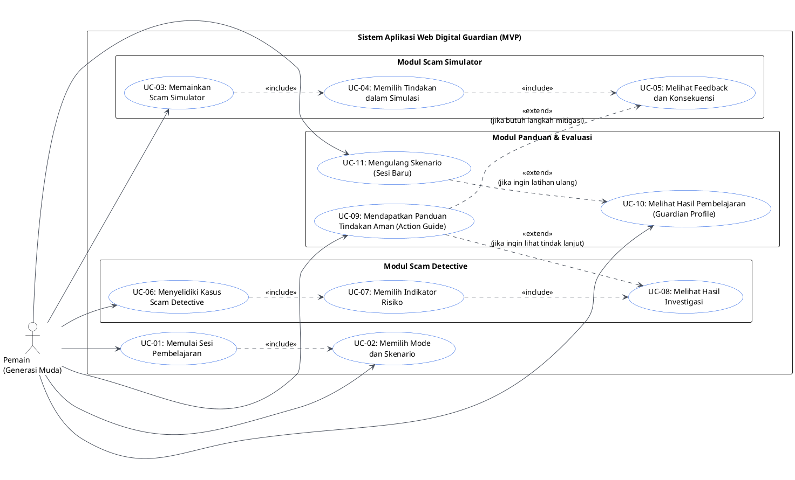

#### Penjelasan Use Case Diagram:
Diagram di atas memetakan 11 Use Case (`UC-01` s.d. `UC-11`) yang berpusat pada tujuan Pemain. Pemain dapat langsung memulai sesi dan memilih skenario (`UC-01`, `UC-02`), berlatih di *Scam Simulator* (`UC-03` beserta `UC-04` dan `UC-05`), menginvestigasi kasus di *Scam Detective* (`UC-06` beserta `UC-07` dan `UC-08`), membuka *Action Guide* (`UC-09`) baik secara langsung maupun sebagai perluasan (`<<extend>>`) dari hasil evaluasi, meninjau rangkasan *Guardian Profile* (`UC-10`), serta mengulang skenario pada sesi baru (`UC-11`).

### 3.3 Tabel Deskripsi Use Case dan Keterkaitan dengan Functional Requirements

| ID Use Case | Nama Use Case | Aktor | Tujuan | Precondition | Main Flow (Alur Utama) | Alternative / Exception Flow | Postcondition | Relasi FR |
| :--- | :--- | :--- | :--- | :--- | :--- | :--- | :--- | :--- |
| **UC-01** | Memulai Sesi Pembelajaran | Pemain | Memulai kegiatan belajar interaktif di Digital Guardian. | Pemain membuka URL aplikasi Digital Guardian di peramban. | 1. Sistem merender halaman utama dengan informasi pengantar dan pilihan modul.<br>2. Pemain menekan tombol mulai latihan.<br>3. Sistem menginisialisasi konteks sesi (`LEARNING_SESSION`) dan mengarahkan ke pemilihan mode/skenario (`UC-02`). | **A1**: Jika terdapat sesi aktif di `sessionStorage`, sistem memulihkan state sesi tersebut atau mengizinkan pemain memulai sesi baru. | Sesi pembelajaran aktif tersedia di memori aplikasi. | FR-01, FR-03 |
| **UC-02** | Memilih Mode dan Skenario | Pemain | Menentukan mode latihan (*Simulator* atau *Detective*) beserta skenario spesifik. | Halaman utama atau pemilih modul telah tampil. | 1. Pemain memilih tab/bagian *Scam Simulator* atau *Scam Detective*.<br>2. Sistem menampilkan daftar skenario pada mode tersebut.<br>3. Pemain memilih salah satu skenario.<br>4. Sistem membuat sesi baru untuk skenario terpilih dan memuat data awalnya. | **A1**: Pemain berpindah skenario saat skenario lama belum selesai -> Sistem mereset sesi skenario tersebut menjadi sesi baru yang bersih. | Skenario terpilih siap dimainkan pada sesi aktif. | FR-02, FR-03 |
| **UC-03** | Memainkan Scam Simulator | Pemain | Mengikuti simulasi percakapan interaktif bercabang sampai selesai. | Pemain telah memilih skenario bertipe `SIMULATOR`. | 1. Sistem menampilkan identitas pengirim fiktif dan pesan pada node awal (`SCENARIO_NODE`).<br>2. Pemain menjalankan pemilihan tindakan (`UC-04`) dan membaca *feedback* (`UC-05`).<br>3. Sistem memuat node cabang berikutnya sesuai pilihan pemain hingga mencapai node akhir (`next_node_id = null`). | **A1**: Pilihan pemain memicu kondisi *Game Over* / kompromi fatal lebih awal -> Sistem langsung menampilkan *feedback* akhir dan menyelesaikan skenario. | Skenario simulasi selesai dan skor tercatat pada hasil sesi. | FR-04, FR-05 |
| **UC-04** | Memilih Tindakan dalam Simulasi | Pemain | Menentukan respons/keputusan terhadap pesan mencurigakan di setiap tahap. | Node percakapan aktif dan daftar pilihan (`CHOICE`) ditampilkan. | 1. Pemain membaca pesan karakter fiktif.<br>2. Pemain memilih salah satu opsi respons.<br>3. Sistem memvalidasi bahwa `choice_id` sah untuk node aktif.<br>4. Sistem mengevaluasi bobot skor (`score_delta`) dan tingkat risiko pilihan, lalu mencatatnya ke `SESSION_ANSWER`. | **E1 (FR-14)**: Jika `choice_id` tidak valid atau sudah pernah dikirim pada step yang sama, sistem menolak aksi ganda dan mempertahankan konsistensi state. | Keputusan pemain tercatat dan siap ditampilkan umpan baliknya. | FR-05, FR-06, FR-14 |
| **UC-05** | Melihat Feedback dan Konsekuensi | Pemain | Memahami tingkat risiko, alasan keamanan, dan dampak dari pilihan yang diambil. | Pemain baru saja memilih tindakan pada `UC-04`. | 1. Sistem menampilkan kartu *feedback* berisi status risiko, penjelasan edukatif, dan konsekuensi.<br>2. Pemain membaca penjelasan.<br>3. Pemain menekan tombol lanjut ke tahap berikutnya (atau lihat evaluasi akhir jika skenario berakhir). | **A1 (`<<extend>>` ke UC-09)**: Jika keputusan pemain berisiko tinggi, sistem menampilkan tautan cepat menuju situasi *Action Guide* yang relevan. | Pemain memahami alasan di balik evaluasi keputusannya. | FR-07 |
| **UC-06** | Menyelidiki Kasus Scam Detective | Pemain | Memeriksa bukti-bukti kasus fiktif untuk mengidentifikasi indikasi penipuan. | Pemain telah memilih skenario bertipe `DETECTIVE`. | 1. Sistem menampilkan deskripsi kasus dan daftar bukti (`SCENARIO_EVIDENCE` seperti profil pengirim, isi pesan, tautan fiktif).<br>2. Pemain memeriksa bukti satu per satu.<br>3. Pemain memilih indikator risiko (`UC-07`) dan mengevaluasi hasil investigasi (`UC-08`). | **A1**: Pemain meninjau ulang bukti dan mengubah pilihan indikator sebelum menekan tombol kirim. | Kasus selesai diselidiki dan nilai investigasi tercatat. | FR-08 |
| **UC-07** | Memilih Indikator Risiko | Pemain | Menandai petunjuk/indikator yang dianggap mencurigakan pada kasus. | Bukti kasus dan daftar indikator (`RISK_INDICATOR`) telah tampil. | 1. Pemain memilih satu atau lebih indikator risiko pada matriks pilihan.<br>2. Pemain menekan tombol "Evaluasi Bukti Investigasi".<br>3. Sistem memvalidasi bahwa minimal 1 indikator telah dipilih.<br>4. Sistem menyimpan pilihan ke `SESSION_ANSWER`. | **E1 (FR-14)**: Pemain menekan tombol evaluasi tanpa memilih satu pun indikator -> Sistem membatalkan evaluasi dan menampilkan pesan peringatan *"Pilih minimal satu indikator risiko terlebih dahulu."* | Daftar indikator pilihan pemain tervalidasi untuk dievaluasi. | FR-08, FR-09, FR-14 |
| **UC-08** | Melihat Hasil Investigasi | Pemain | Mengetahui ketepatan indikator yang dipilih, indikator yang terlewat, dan penjelasan buktinya. | Pemain telah mengirimkan pilihan indikator yang valid pada `UC-07`. | 1. Sistem membandingkan pilihan pemain dengan `SCENARIO_INDICATOR` target.<br>2. Sistem menghitung jumlah indikator **Tepat**, **Tidak Tepat (Keliru)**, dan **Terlewat**.<br>3. Sistem menampilkan rincian evaluasi beserta penjelasan bukti pendukung (`EVIDENCE_INDICATOR`). | **A1 (`<<extend>>` ke UC-09)**: Pemain menekan rekomendasi panduan tindakan terkait indikator yang ditemukan/terlewat. | Hasil investigasi tampil dan terakumulasi ke sesi pembelajaran. | FR-09, FR-11 |
| **UC-09** | Mendapatkan Panduan Tindakan Aman | Pemain | Memperoleh langkah penanganan insiden yang tepat sesuai situasi yang dihadapi. | Pemain membuka bagian *Action Guide* atau mengeklik rujukan dari hasil evaluasi. | 1. Sistem menampilkan 4 kategori situasi insiden.<br>2. Pemain memilih situasi yang dialami (misal: *Sudah memasukkan OTP*).<br>3. Sistem menampilkan daftar langkah penanganan berurutan, rujukan kanal resmi, dan *disclaimer* edukasi. | **A1**: Pemain membuka beberapa situasi secara bergantian menggunakan komponen *native disclosure* (`<details>`). | Pemain mendapatkan informasi langkah mitigasi yang relevan. | FR-10 |
| **UC-10** | Melihat Hasil Pembelajaran (Guardian Profile) | Pemain | Melihat rangkuman skor sesi, keputusan berisiko, indikator terlewat, dan rekomendasi belajar. | Minimal satu skenario Simulator atau Detective telah diselesaikan dalam sesi aktif. | 1. Sistem mengagregasi data jawaban sesi menjadi `SESSION_RESULT`.<br>2. Sistem menampilkan *Guardian Profile* berisi skor sesi, statistik keputusan tepat/berisiko, daftar indikator terlewat, kategori kemampuan, dan rekomendasi latihan. | **A1**: Jika pemain belum menyelesaikan skenario apa pun, bagian *Guardian Profile* menampilkan status awal (*empty state*) dengan ajakan memulai simulasi. | Ringkasan evaluasi sesi ditampilkan secara transparan kepada pemain. | FR-11, FR-12 |
| **UC-11** | Mengulang Skenario (Sesi Baru) | Pemain | Memainkan kembali skenario dari awal dengan sesi baru tanpa tercampur skor lama. | Pemain telah menyelesaikan skenario atau berada di panel *Guardian Profile*. | 1. Pemain menekan tombol "Ulangi Skenario" atau "Reset Sesi Evaluasi".<br>2. Sistem mengarsipkan/menghapus state sesi lama dan membuat `LEARNING_SESSION` baru.<br>3. Sistem merender ulang node awal skenario atau mereset pilihan indikator. | - | Sesi baru terbentuk dengan skor awal bersih dan siap dimainkan ulang. | FR-03, FR-13 |

---

## BAGIAN 4 — ACTIVITY DIAGRAM

Empat Activity Diagram dirancang menggunakan **Mermaid Flowchart** untuk memodelkan alur proses yang memiliki logika keputusan, validasi, pengulangan, dan percabangan utama.

### 4.1 Activity Diagram 1: Alur Scam Simulator
**Mendukung Use Case:** `UC-02`, `UC-03`, `UC-04`, `UC-05`, `UC-10`, `UC-11`

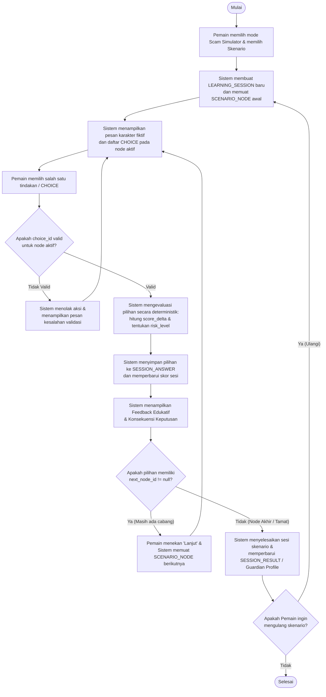

#### Penjelasan Alur Scam Simulator:
1. Ketika pemain memilih skenario simulasi, sistem selalu membuat sesi baru dan mengambil node pertama.
2. Setiap pilihan pemain divalidasi terlebih dahulu (`FR-14`). Jika valid, *Rule Engine* menilai perubahan skor dan tingkat risiko (`FR-06`), menyimpannya ke `SESSION_ANSWER`, lalu menampilkan *feedback* konsekuensi (`FR-07`).
3. Percabangan sesungguhnya terjadi pada decision **`next_node_id != null`**: pilihan yang berbeda mengarahkan ke ID node tujuan yang berbeda (`FR-05`). Ketika `next_node_id` bernilai `null`, sesi diselesaikan dan dirangkum ke *Guardian Profile* (`FR-11`, `FR-12`).

---

### 4.2 Activity Diagram 2: Alur Scam Detective
**Mendukung Use Case:** `UC-02`, `UC-06`, `UC-07`, `UC-08`, `UC-09`, `UC-10`, `UC-11`

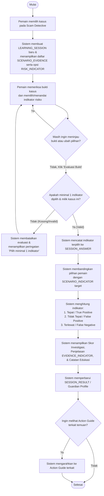

#### Penjelasan Alur Scam Detective:
1. Pemain memeriksa bukti fiktif (pesan, klaim, URL, profil) dan dapat mengubah-ubah centang indikator risiko sebelum menekan tombol pengiriman.
2. Saat dikirim, sistem memvalidasi agar pengiriman kosong dicegah (`FR-14`).
3. Sistem membandingkan himpunan indikator yang dipilih pemain terhadap himpunan indikator target pada kasus tersebut (`FR-09`), memisahkan mana yang **Tepat**, **Keliru**, dan **Terlewat**, lalu menampilkan penjelasan mengapa bukti tertentu mendukung indikator tersebut (`EVIDENCE_INDICATOR`).

---

### 4.3 Activity Diagram 3: Alur Action Guide
**Mendukung Use Case:** `UC-09`

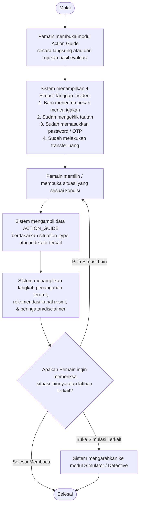

#### Penjelasan Alur Action Guide:
Alur ini memastikan pengguna yang sedang panik atau ingin belajar langkah mitigasi dapat langsung memilih kondisi keterlanjurannya tanpa harus menyelesaikan kuis terlebih dahulu. Sistem menampilkan langkah-langkah terstruktur sesuai `situation_type` (`FR-10`).

---

### 4.4 Activity Diagram 4: Alur Penyelesaian Sesi dan Pembentukan Guardian Profile
**Mendukung Use Case:** `UC-10`, `UC-11`

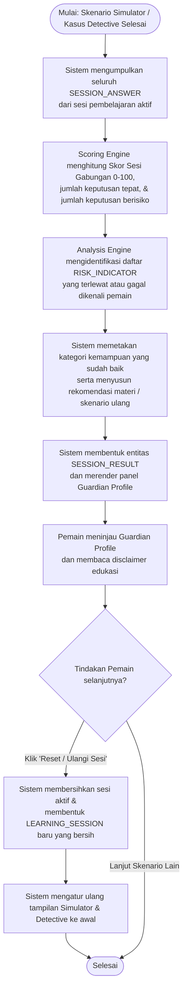

#### Penjelasan Alur Pembentukan Guardian Profile:
Setiap kali pemain menuntaskan skenario Simulator atau evaluasi Detective, sistem mengagregasi seluruh jawaban di dalam sesi aktif untuk menghasilkan satu ringkasan `SESSION_RESULT` yang ditampilkan pada bagian **Guardian Profile** (`FR-11`, `FR-12`). Jika pemain memilih reset/ulangi (`FR-13`), state sesi lama dibersihkan sehingga percobaan berikutnya dimulai dari kondisi nol.

---

## BAGIAN 5 — SYSTEM ARCHITECTURE DESIGN

### 5.1 Evaluasi dan Perbandingan Alternatif Arsitektur untuk MVP
Sesuai instruksi studi kasus, kita membandingkan tiga pendekatan arsitektur yang relevan:

| Kriteria Pembanding | Opsi 1: Client-Side React SPA + Structured JSON Engine (Dipilih untuk MVP) | Opsi 2: React Frontend + Backend REST API + PostgreSQL (Modular Monolith) | Opsi 3: Microservices Architecture |
| :--- | :--- | :--- | :--- |
| **Kesesuaian dengan Batasan MVP** | **Sangat Sesuai**. MVP tidak butuh login, tidak butuh penyimpanan lintas sesi permanen, dan skenario bersifat deterministik. | **Sesuai untuk Fase 2**, namun menambah kompleksitas server & database yang belum wajib pada MVP tanpa akun. | **Tidak Sesuai (Overengineered)**. Terlalu rumit untuk skala aplikasi edukasi tanpa transaksi kompleks. |
| **Kecepatan Respons (NFR-03)** | **Instan (< 50 ms)**. Seluruh evaluasi percabangan dan indikator berjalan di memori peramban tanpa latensi jaringan. | Bergantung pada *round-trip* HTTP API dan *cold start* server gratis (100 ms – 3 detik). | Latensi tinggi akibat komunikasi antar-layanan (*network hop*). |
| **Ketersediaan & Deployment (NFR-04)** | **Sangat Tinggi (99.9%) & Gratis**. Di-deploy ke Static CDN (Vercel / Cloudflare Pages / Netlify) tanpa risiko *database sleep*. | Rawan *downtime* jika *free-tier* backend/DB mengalami *sleep mode* saat diuji juri. | Mahal dan sulit dipelihara oleh tim kecil. |
| **Privasi & Keamanan (NFR-05/06/07)** | **Maksimal**. Tidak ada data pengguna yang dikirim ke server eksternal; permukaan serangan (*attack surface*) sangat kecil. | Memerlukan proteksi *rate limiting*, CORS, dan pengamanan database dari spam. | Memerlukan *API Gateway* dan manajemen rahasia yang kompleks. |
| **Kemudahan Ekstensi ke Backend** | Dirancang dengan **Repository/Service Pattern** di React sehingga sumber data JSON dapat diganti ke panggilan REST API kapan saja tanpa merombak komponen UI. | Sudah memiliki backend sejak awal, namun waktu *development* MVP terbagi dua. | Sangat lambat untuk dikembangkan. |

#### Keputusan Arsitektur:
Untuk **MVP Digital Guardian**, arsitektur yang dipilih adalah **Modular Client-Side React Application (SPA) dengan Deterministic Engine & Repository Layer yang Siap Diintegrasikan ke Backend REST API (Hybrid-Ready Modular Architecture)**.
- **Alasan Pemilihan**:
  1. Memenuhi 100% kebutuhan fungsional (`FR-01` s.d. `FR-14`) dan non-fungsional (`NFR-01` s.d. `NFR-12`) dengan keandalan tertinggi saat diuji juri melalui URL publik.
  2. Logika bisnis (*Scenario Engine*, *Analysis/Rule Engine*, *Scoring Engine*, dan *Action Guide Engine*) diisolasi ke dalam modul TypeScript murni (*pure domain services*) di luar komponen UI React.
  3. Apabila tim mengaktifkan Backend API dan PostgreSQL (disediakan rancangannya secara lengkap pada Bagian 7 dan Bagian 8), aplikasi cukup mengganti `JsonScenarioRepository` menjadi `ApiScenarioRepository` melalui *Dependency Injection / Custom Hook* tanpa mengubah satu baris pun kode tampilan React.

---

### 5.2 Arsitektur Visual & Desain Antarmuka React ("Software" Minimalist Design System)
Sesuai dengan skill `frontend-design` dan spesifikasi `<design-system># Software`, arsitektur komponen React dibangun di atas sistem token desain yang ketat dan minimalis:

#### 1. Sistem Token Desain Otoritatif (`src/styles/tokens.css`)
- **Surface & Background Continuity**:
  - `--dp-color-ground: #fcfcfd` (Latar dasar halaman yang bersih dan terbuka — digunakan pada *Header*, *Hero Section*, dan *Action Guide*).
  - `--dp-color-ground-muted: #f3f4f6` (Latar abu-abu pucat untuk pengelompokan konten analisis — digunakan pada *Module Overview* dan *Scam Detective*).
  - `--dp-color-panel: #ffffff` (Kartu putih dengan border halus `1px solid #dde0e6`, radius `12px`, dan bayangan lembut ke bawah).
  - `--dp-color-field: #16191f` dengan teks `--dp-color-on-field: #fcfcfd` dan `--dp-color-on-field-secondary: #d0d4dd` (**Dua Continuous Dark Fields**: digunakan secara sengaja hanya pada ruang latihan **Scam Simulator** dan ruang penutup **Guardian Profile & Footer** untuk menciptakan fokus imersif).
- **Typography & Hierarchy**:
  - `--font-display: 'Host Grotesk', sans-serif` (Digunakan untuk judul, metrik skor besar, dan header bagian dengan *tight tracking* `-0.025em` serta `line-height: 1.15`).
  - `--font-body: 'Instrument Sans', sans-serif` (Digunakan untuk paragraf edukasi, balon percakapan, label kontrol, dan bukti dengan ukuran `16px`, `line-height: 1.6`, dan lebar baca `< 75ch`).
- **Action & Focus Restraint**:
  - `--dp-color-accent: #074ce0` (*Electric Blue* — hanya digunakan untuk tombol aksi utama, indikator yang sedang dipilih, dan titik fokus diagram; tidak digunakan sebagai dekorasi acak).
  - Keyboard Accessibility: `:focus-visible` wajib menampilkan `outline: 2px solid #074ce0; outline-offset: 2px`.
  - Motion Restraint: Transisi interaksi `160ms ease-out`, diagram hero statis (tenang), dan mematuhi `@media (prefers-reduced-motion: reduce)`.

#### 2. Struktur Hirarki Komponen React (`src/`)
```text
src/
├── main.tsx                        # Entry point React 18
├── App.tsx                         # Layout utama dengan urutan Background Continuity
├── styles/
│   ├── tokens.css                  # CSS Custom Properties (--dp-*) dari skill Software Design
│   └── global.css                  # Reset, tipografi Host Grotesk & Instrument Sans, utilitas a11y
├── types/
│   └── domain.ts                   # Kontrak TypeScript (Scenario, Node, Choice, Evidence, Session, dll.)
├── data/
│   ├── scenarios.json              # Data skenario Simulator & Detective tervalidasi
│   ├── riskIndicators.json         # Katalog indikator risiko standar
│   └── actionGuides.json           # Data panduan 4 situasi tanggap insiden
├── engines/                        # Pure TypeScript Domain Engines (Deterministic & Unit-Testable)
│   ├── ScenarioEngine.ts           # Mengelola state node, transisi next_node_id, dan validasi pilihan
│   ├── AnalysisEngine.ts           # Mengevaluasi indikator risiko Detective (TP, FP, FN) & bukti
│   ├── ScoringEngine.ts            # Menghitung skor sesi (0-100), profil risiko, dan rekomendasi
│   └── ActionGuideEngine.ts        # Memfilter panduan berdasarkan situation_type atau indikator
├── context/
│   └── LearningSessionContext.tsx  # React Context + useReducer + sessionStorage sync untuk sesi aktif
└── components/
    ├── layout/
    │   ├── Header.tsx              # Navigasi minimalis & status sesi aktif
    │   ├── HeroSection.tsx         # Split 1.45:1 + Compact Threat Convergence Diagram + Ruled Facts Strip
    │   └── Footer.tsx              # Dark closing & transparansi edukasi
    ├── simulator/                  # [Continuous Dark Field 1: #16191f]
    │   ├── ScamSimulatorSection.tsx
    │   ├── ScenarioSelector.tsx
    │   ├── ChatViewport.tsx        # Balon pesan bertahap & status risiko
    │   ├── ChoicePanel.tsx         # Tombol keputusan kontekstual
    │   └── FeedbackBanner.tsx      # Penjelasan konsekuensi instan & rujukan Action Guide
    ├── detective/                  # [Pale Field: #f3f4f6]
    │   ├── ScamDetectiveSection.tsx
    │   ├── EvidenceViewer.tsx      # Panel bukti pesan, klaim, URL, dan metadata pengirim fiktif
    │   ├── IndicatorChecklist.tsx  # Matriks pemilihan indikator risiko dengan state aria-pressed/checked
    │   └── DetectiveEvaluation.tsx # Rincian indikator Tepat, Keliru, dan Terlewat
    ├── guide/                      # [Open Ground Field: #fcfcfd]
    │   ├── ActionGuideSection.tsx
    │   └── SituationDisclosure.tsx # Native <details>/<summary> dengan ikon plus berputar 45 derajat
    └── profile/                    # [Continuous Dark Field 2: #16191f]
        ├── GuardianProfileSection.tsx
        ├── ScoreSummaryCard.tsx    # Skor akhir, keputusan tepat/berisiko, indikator terlewat
        └── RecommendationList.tsx  # Rekomendasi latihan & tombol Reset Sesi
```

---

### 5.3 Diagram Arsitektur (C4 Model: Context, Container, Component)

#### 1. System Context Diagram (C4 Level 1)
Menunjukkan hubungan antara Pemain dengan sistem Digital Guardian secara keseluruhan.

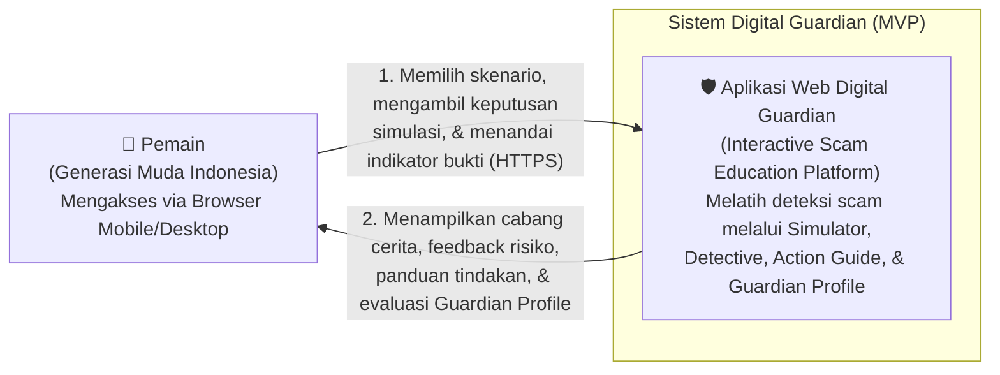

**Penjelasan System Context Diagram:**  
Pemain berinteraksi langsung dengan aplikasi web Digital Guardian melalui koneksi HTTPS tanpa memerlukan sistem autentikasi pihak ketiga atau pengiriman data pribadi keluar sistem.

---

#### 2. Container Diagram (C4 Level 2)
Menampilkan wadah eksekusi (*containers*) pada arsitektur MVP serta jalur integrasi opsional apabila Backend API diaktifkan.

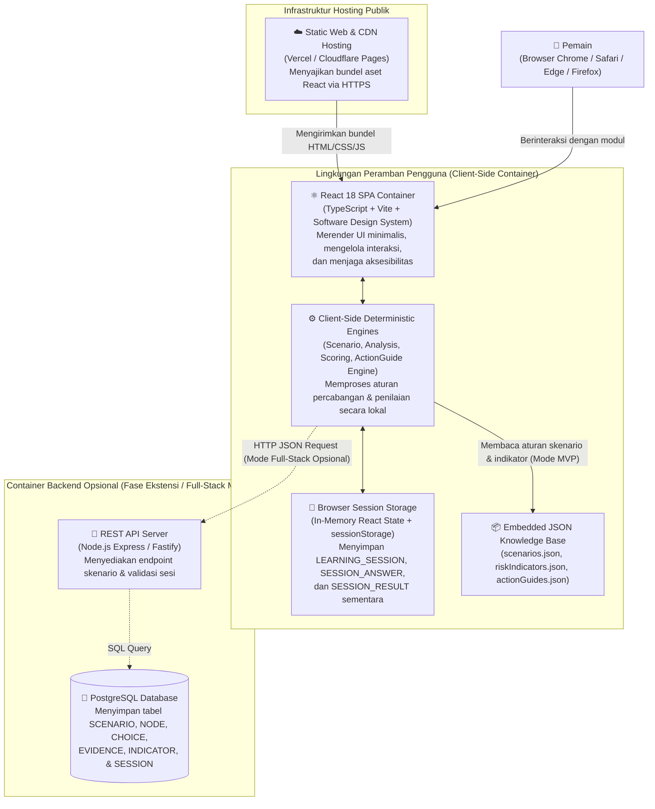

**Penjelasan Container Diagram:**  
Pada mode MVP, seluruh aplikasi dimuat dari **Static Web & CDN Hosting** ke dalam peramban pemain. **React 18 SPA Container** berkomunikasi langsung dengan **Client-Side Deterministic Engines** yang membaca katalog skenario dari **Embedded JSON Knowledge Base** dan menyimpan progres sesi aktif di **Browser Session Storage**. Jika tim membutuhkan penyimpanan terpusat, lapisan repositori dapat diarahkan ke **REST API Server** dan **PostgreSQL Database**.

---

#### 3. Component Diagram (C4 Level 3 — Arsitektur Internal React & Engines)
Menjelaskan komponen internal aplikasi React dan aliran data antar-modul.

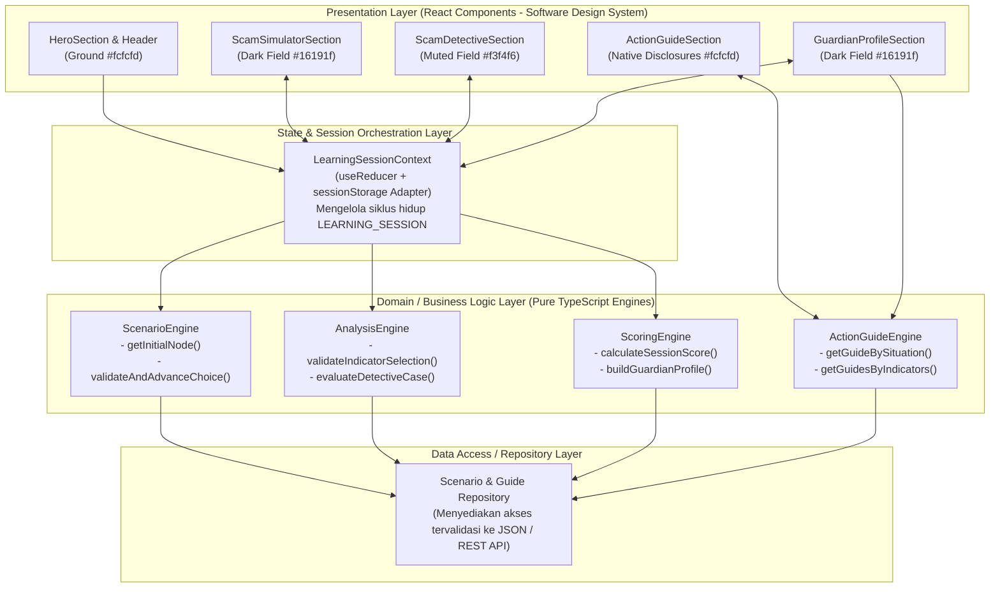

### 5.4 Tanggung Jawab Setiap Komponen dan Aliran Data
1. **Presentation Layer (React Components)**: Bertanggung jawab merender state menjadi elemen DOM yang semantik, aksesibel, dan sesuai token *Software Design System*. Tidak boleh menghitung skor secara langsung di dalam JSX.
2. **LearningSessionContext (State Orchestration)**: Menyimpan objek `LearningSession`, daftar `SessionAnswer`, dan `SessionResult` yang sedang aktif. Menerima aksi dari pengguna (`START_SCENARIO`, `SUBMIT_CHOICE`, `SUBMIT_DETECTIVE`, `RESET_SESSION`) dan mendelegasikannya ke *Engine Layer*.
3. **ScenarioEngine**: Memvalidasi apakah `choice_id` milik `node_id` aktif, mengambil perubahan skor (`score_delta`), menentukan `next_node_id`, dan mengembalikan objek *feedback*.
4. **AnalysisEngine**: Memvalidasi pilihan indikator risiko pada *Scam Detective*, membandingkannya dengan `SCENARIO_INDICATOR` target, memetakan bukti pendukung (`EVIDENCE_INDICATOR`), dan mengklasifikasikan hasil menjadi *True Positive* (Tepat), *False Positive* (Tidak Tepat), dan *False Negative* (Terlewat).
5. **ScoringEngine**: Mengagregasi seluruh jawaban sesi dari Simulator dan Detective menjadi skor ternormalisasi (`0–100`), menyusun daftar keputusan berisiko, indikator terlewat, kategori kemampuan yang sudah dikuasai, serta rekomendasi skenario/materi.
6. **ActionGuideEngine**: Mengambil langkah-langkah panduan tanggap insiden berdasarkan `situation_type` (4 kondisi utama) maupun berdasarkan daftar `indicator_id` yang terlewat oleh pemain.
7. **Scenario & Guide Repository**: Mengabstraksi sumber data (file JSON statis pada MVP atau panggilan `fetch()` ke REST API pada arsitektur backend).


---

## BAGIAN 6 — DETAILED DESIGN SETIAP MODUL

Bagian ini merinci desain internal dari modul-modul utama Digital Guardian beserta fitur utilitas praktis (*Real-Time Heuristic Scam & Link Scanner*, *Interactive Incident Checklist*, *Report Generator*, dan *Verified Emergency Directory*).

### 6.1 Modul Utilitas Praktis: Heuristic Scam, Link & File Scanner (`#scanner`)
Fitur fungsional sehari-hari yang memungkinkan pengguna menempelkan teks pesan mencurigakan, URL, atau nama file yang baru mereka terima untuk dianalisis secara deterministik di sisi peramban (*100% client-side privacy*):
- **Vektor Pemeriksaan (`analyzeMessageAndLinks`)**:
  1. **Deteksi Ekstensi Berbahaya (`MALICIOUS_ATTACHMENT`)**: Mencocokkan pola RegEx terhadap ekstensi `.apk`, `.exe`, `.scr`, `.bat`, `.vbs` serta penyamaran *double extension* (`.pdf.apk`, `.jpg.apk`).
  2. **Bedah Anatomi URL (`URL_ANATOMY_INSPECTOR`)**: Mengurai hostname URL, memverifikasi terhadap daftar *Official Domains* (`.co.id`, `.go.id`), mendeteksi *High-Risk Phishing TLDs* (`.vip`, `.xyz`, `.top`, `.click`, `.buzz`, `.my.id`), mendeteksi *Link Shorteners* (`bit.ly`, `s.id`, `tinyurl.com`), dan mengidentifikasi *Brand Impersonation* (pencatutan nama bank/ekspedisi pada domain asing).
  3. **Deteksi Permintaan Kredensial (`CREDENTIAL_HARVESTING`)**: Mendeteksi kata kunci `OTP`, `PIN`, `CVV`, `CVC`, `kata sandi`, `akses SMS`, `Izinkan Semua`.
  4. **Deteksi Manipulasi Urgensi & Umpan Finansial**: Mendeteksi ancaman waktu sempit (`dalam 15 menit`, `diblokir otomatis`) serta skema *advance-fee / deposit tugas VIP*.
- **Output Terhubung ke Action Guide**: Menghasilkan indeks risiko (`0–100`), rincian kutipan kalimat berbahaya, dan tombol rujukan langsung menuju situasi *Action Guide* yang relevan (`#guide-sit-1` s.d. `#guide-sit-4`).

### 6.2 Modul Utama A: Scam Simulator (`#simulator`)
- **Struktur Skenario (`SCENARIO`)**: Menyimpan metadata skenario (`scenario_id`, `title`, `description`, `contact_name`, `contact_status`, `initial_node_id`).
- **Struktur Node (`SCENARIO_NODE`)**: Merepresentasikan tahapan percakapan (`node_id`, `step_order`, `bot_messages[]`, `choices[]`).
- **Struktur Pilihan (`CHOICE`)**: Memiliki atribut `choice_id`, `label`, `next_node_id` (`string | null`), `consequence_type` (`BEST | SAFE | ELEVATED | DANGEROUS | GAME_OVER | RECOVERY`), `risk_level`, `score_delta`, `feedback_title`, dan `feedback_text`.
- **Mekanisme Percabangan & Penilaian**:
  - Ketika pengguna memilih opsi `CHOICE`, `ScenarioEngine` memvalidasi bahwa pilihan tersebut sah untuk node aktif, mengakumulasikan `score_delta` ke skor skenario (dibatasi pada rentang `0–100`), mencatat jumlah keputusan aman vs keputusan berisiko ke `sessionState`, dan menampilkan `FeedbackBanner`.
  - Saat pengguna menekan tombol lanjut, sistem berpindah ke `SCENARIO_NODE` yang dirujuk oleh `next_node_id`. Apabila `next_node_id === null`, skenario selesai dan skor disimpan ke `Guardian Profile`.

### 6.3 Modul Utama B: Scam Detective (`#detective`)
- **Struktur Kasus & Bukti (`SCENARIO_EVIDENCE`)**: Mendukung multi-kasus investigasi (*Undian .VIP*, *Panggilan HRD Palsu*, *Tagihan Bea Cukai Palsu*). Setiap kasus memiliki metadata pengirim dan blok-blok bukti interaktif.
- **Indikator Risiko Target (`isRisk: true`) vs Elemen Pengecoh (`isRisk: false`)**:
  - Untuk memastikan pengujian berpikir kritis yang nyata, bukti kasus memuat **Indikator Risiko Target** sekaligus **Elemen Pengecoh (Normal/Safe Statements)**.
- **Mekanisme Evaluasi Jawaban & Perhitungan Skor (`FR-09`, `FR-14`)**:
  - **Validasi Input (`FR-14`)**: Jika pengguna menekan *"Kirim Laporan Investigasi"* saat belum ada satu pun elemen yang dipilih (`selectedIds.length === 0`), sistem menampilkan `validation-banner` dan menolak evaluasi kosong.
  - **Rumus Skor Investigasi Deterministik**:
    $$\text{Skor Kasus} = \max\left(0, \text{round}\left(\frac{\text{True Positives}}{\text{Total Target Indicators}} \times 100\right) - (\text{False Positives} \times 15)\right)$$
  - Menampilkan penjelasan bukti pendukung untuk setiap indikator yang **Tepat Dikenali (True Positive)**, **Indikator Terlewat (False Negative)**, maupun **Tuduhan Keliru (False Positive)**.

### 6.4 Modul Utama C: Action Guide & Emergency Toolkit (`#guide` & `#emergency-tools`)
- **Pengelompokan 4 Situasi Insiden (`FR-10`)**:
  1. `RECEIVED_SUSPICIOUS_MESSAGE` (Baru menerima pesan mencurigakan)
  2. `CLICKED_MALICIOUS_LINK` (Sudah mengeklik tautan / mengunduh `.apk`)
  3. `SUBMITTED_CREDENTIALS_OR_OTP` (Sudah memasukkan kata sandi / PIN / OTP)
  4. `TRANSFERRED_MONEY` (Sudah melakukan transfer uang ke penipu)
- **Checklist Penyelamatan Interaktif**: Setiap situasi dilengkapi *checkbox* interaktif (`guide-step-check`) yang tersimpan di `sessionStorage` dan menghitung persentase progres mitigasi darurat (`0%`–`100%`).
- **Generator Kronologi Laporan Resmi & Peringatan Grup WA**: Menyusun draf laporan kronologi formal untuk Call Center Bank / CekRekening.id / SPKT Kepolisian serta draf peringatan singkat untuk dibagikan ke grup WhatsApp keluarga.
- **Direktori Kontak Darurat Terverifikasi**: Menyediakan pencarian cepat nomor Call Center resmi Bank Nasional, E-Wallet, OJK 157, CekRekening.id, dan Patroli Siber untuk mencegah korban menghubungi CS palsu di media sosial.

### 6.5 Modul Utama D: Guardian Profile (`#guardian-profile-card`)
- **Agregasi Skor Sesi (`FR-11`, `FR-12`)**: Menghitung rata-rata skor dari seluruh skenario Simulator dan kasus Detective yang telah diselesaikan dalam sesi aktif (`sessionId`), merangkum total keputusan berisiko, jumlah indikator tepat/keliru, kategori kemampuan terkuat, serta rekomendasi spesifik berdasarkan indikator yang terlewat.
- **Fitur Salin Ringkasan & Reset Sesi (`FR-13`)**: Menyediakan tombol *Salin Ringkasan Sesi* ke *clipboard* dan tombol *Reset Seluruh Sesi* yang menghapus state lama di `sessionStorage` lalu membentuk `sessionId` baru yang bersih.

---

## BAGIAN 7 — DATABASE DESIGN DAN ERD

### 7.1 Evaluasi Entitas dan Strategi Penyimpanan (JSON + SessionStorage pada MVP vs PostgreSQL pada Full-Stack)
Sesuai pedoman studi kasus, ke-12 entitas dievaluasi secara kritis:
1. **Pada Implementasi MVP (Client-Side Statis & Ephemeral Session)**:
   - Entitas katalog konten (`SCENARIO`, `SCENARIO_NODE`, `CHOICE`, `SCENARIO_EVIDENCE`, `RISK_INDICATOR`, `SCENARIO_INDICATOR`, `EVIDENCE_INDICATOR`, `ACTION_GUIDE`, `INDICATOR_ACTION`) disimpan sebagai **struktur data JSON statis tervalidasi** di dalam aplikasi.
   - Entitas transaksional sesi (`LEARNING_SESSION`, `SESSION_ANSWER`, `SESSION_RESULT`) disimpan sebagai **objek JSON sementara di `window.sessionStorage`** selama tab peramban pengguna aktif.
2. **Pada Implementasi Full-Stack / Fase Ekstensi (PostgreSQL)**:
   - Ke-12 entitas diimplementasikan menjadi tabel relasional terindeks dalam **PostgreSQL** dengan normalisasi **3NF (Third Normal Form)**.

### 7.2 Entity Relationship Diagram (Mermaid `erDiagram`)

```mermaid
erDiagram
    SCENARIO ||--o{ SCENARIO_NODE : "memiliki tahapan (1:N)"
    SCENARIO ||--o{ SCENARIO_EVIDENCE : "memiliki bukti kasus (1:N)"
    SCENARIO ||--o{ SCENARIO_INDICATOR : "memiliki target indikator (1:N)"
    SCENARIO ||--o{ LEARNING_SESSION : "dimainkan dalam sesi (1:N)"

    SCENARIO_NODE ||--o{ CHOICE : "menyediakan pilihan (1:N)"
    SCENARIO_NODE o|--o{ CHOICE : "dirujuk oleh next_node_id (0..1:N)"

    RISK_INDICATOR ||--o{ SCENARIO_INDICATOR : "digunakan pada skenario (1:N)"
    RISK_INDICATOR ||--o{ EVIDENCE_INDICATOR : "didukung oleh bukti (1:N)"
    RISK_INDICATOR ||--o{ INDICATOR_ACTION : "dipetakan ke panduan (1:N)"

    SCENARIO_EVIDENCE ||--o{ EVIDENCE_INDICATOR : "mendukung indikator (1:N)"
    ACTION_GUIDE ||--o{ INDICATOR_ACTION : "merespons indikator (1:N)"

    LEARNING_SESSION ||--o{ SESSION_ANSWER : "mencatat jawaban (1:N)"
    LEARNING_SESSION ||--o| SESSION_RESULT : "menghasilkan evaluasi (1:0..1)"

    CHOICE o|--o{ SESSION_ANSWER : "dipilih pada jawaban simulator (0..1:N)"
    SCENARIO_INDICATOR o|--o{ SESSION_ANSWER : "dipilih pada jawaban detective (0..1:N)"

    SCENARIO {
        varchar(50) scenario_id PK
        varchar(150) title
        text description
        varchar(20) mode "CHECK (SIMULATOR, DETECTIVE)"
        varchar(20) difficulty "EASY, MEDIUM, HARD"
        boolean is_active
    }

    SCENARIO_NODE {
        varchar(50) node_id PK
        varchar(50) scenario_id FK
        int step_order
        varchar(100) sender_name
        varchar(100) sender_meta
        jsonb messages
        boolean is_initial
    }

    CHOICE {
        varchar(50) choice_id PK
        varchar(50) node_id FK
        varchar(50) next_node_id FK "NULLABLE (Akhir Skenario)"
        text choice_text
        varchar(30) consequence_type "BEST, SAFE, ELEVATED, DANGEROUS, GAME_OVER, RECOVERY"
        varchar(50) risk_level
        int score_delta
        varchar(150) feedback_title
        text feedback_text
    }

    SCENARIO_EVIDENCE {
        varchar(50) evidence_id PK
        varchar(50) scenario_id FK
        varchar(30) evidence_type "SENDER, MESSAGE_CLAIM, URL, ATTACHMENT"
        text content_text
        boolean is_decoy_safe
        int display_order
    }

    RISK_INDICATOR {
        varchar(50) indicator_id PK
        varchar(120) name
        varchar(80) category
        varchar(20) severity "LOW, MEDIUM, HIGH, CRITICAL"
        text general_explanation
    }

    SCENARIO_INDICATOR {
        varchar(50) scenario_indicator_id PK
        varchar(50) scenario_id FK
        varchar(50) indicator_id FK
        int weight_score
        boolean is_target
    }

    EVIDENCE_INDICATOR {
        varchar(50) evidence_indicator_id PK
        varchar(50) evidence_id FK
        varchar(50) indicator_id FK
        text evidence_explanation
    }

    ACTION_GUIDE {
        varchar(50) guide_id PK
        varchar(50) situation_type "RECEIVED_MSG, CLICKED_LINK, SHARED_OTP, TRANSFERRED_FUNDS"
        varchar(150) title
        varchar(50) risk_status
        jsonb action_steps
        text official_channels_note
        int display_order
    }

    INDICATOR_ACTION {
        varchar(50) indicator_action_id PK
        varchar(50) indicator_id FK
        varchar(50) guide_id FK
        int priority_order
    }

    LEARNING_SESSION {
        uuid session_id PK
        varchar(50) scenario_id FK
        varchar(20) status "IN_PROGRESS, COMPLETED, RESET"
        timestamp started_at
        timestamp completed_at "NULLABLE"
    }

    SESSION_ANSWER {
        uuid answer_id PK
        uuid session_id FK
        varchar(20) answer_type "CHECK (CHOICE, INDICATOR)"
        varchar(50) choice_id FK "NULLABLE"
        varchar(50) scenario_indicator_id FK "NULLABLE"
        int awarded_score
        timestamp answered_at
    }

    SESSION_RESULT {
        uuid result_id PK
        uuid session_id FK "UNIQUE (1:1 dengan LEARNING_SESSION)"
        int final_score "CHECK (0 <= final_score <= 100)"
        int safe_decisions_count
        int risky_decisions_count
        int missed_indicators_count
        jsonb missed_indicators_summary
        jsonb recommendations
        timestamp generated_at
    }
```

### 7.3 Aturan Validasi, Constraint, Indeks, dan Retensi Data
1. **Check Constraints**:
   - `SCENARIO.mode IN ('SIMULATOR', 'DETECTIVE')`
   - `SESSION_ANSWER`: Constraint eksklusif (`(answer_type = 'CHOICE' AND choice_id IS NOT NULL AND scenario_indicator_id IS NULL) OR (answer_type = 'INDICATOR' AND scenario_indicator_id IS NOT NULL AND choice_id IS NULL)`).
   - `SESSION_RESULT.final_score BETWEEN 0 AND 100` dan `UNIQUE (session_id)` agar setiap sesi hanya memiliki tepat satu hasil akhir.
2. **Indeks Kinerja**:
   - `idx_scenario_node_scen` pada `SCENARIO_NODE(scenario_id, step_order)`
   - `idx_choice_node` pada `CHOICE(node_id)`
   - `idx_session_answer_ses` pada `SESSION_ANSWER(session_id)`
3. **Aturan Penyimpanan & Penghapusan**:
   - Pada MVP, data sesi di `sessionStorage` otomatis dihapus oleh browser ketika pengguna menutup tab, atau dihapus seketika saat tombol **Reset Seluruh Sesi** ditekan.

---

## BAGIAN 8 — API DESIGN (REST API UNTUK MODE FULL-STACK OPSIONAL)

Pada mode MVP Client-Side SPA, aplikasi menggunakan *Local Repository* tanpa memerlukan jaringan backend. Apabila mode Backend REST API diaktifkan, berikut adalah kontrak 8 endpoint RESTful yang konsisten:

| No | Method & Endpoint | Tujuan | Request Params / Body | Response Sukses (200/201) | Validasi & Error Codes |
| :--- | :--- | :--- | :--- | :--- | :--- |
| **1** | `GET /api/v1/scenarios` | Mengambil daftar skenario berdasarkan mode (`SIMULATOR` / `DETECTIVE`). | Query: `?mode=SIMULATOR` | `{ "status": "success", "data": [{ "scenarioId": "courier", "title": "...", "mode": "SIMULATOR" }] }` | `400 Bad Request` jika parameter `mode` tidak valid. |
| **2** | `GET /api/v1/scenarios/:scenarioId` | Mengambil detail skenario beserta node awal atau daftar bukti kasus. | Path: `scenarioId` | `{ "status": "success", "data": { "scenarioId": "courier", "initialNode": {...}, "evidences": [...] } }` | `404 Not Found` jika `scenarioId` tidak ditemukan. |
| **3** | `POST /api/v1/sessions` | Memulai sesi pembelajaran baru (`LEARNING_SESSION`). | Body: `{ "scenarioId": "courier" }` | `{ "status": "success", "data": { "sessionId": "uuid-v4", "status": "IN_PROGRESS", "currentScore": 100 } }` | `400 Bad Request` jika `scenarioId` kosong; `404` jika skenario tidak aktif. |
| **4** | `GET /api/v1/sessions/:sessionId/nodes/:nodeId` | Mengambil pesan dan daftar pilihan pada tahap/node simulasi tertentu. | Path: `sessionId`, `nodeId` | `{ "status": "success", "data": { "nodeId": "n2", "messages": [...], "choices": [...] } }` | `404 Not Found` jika sesi atau node tidak ditemukan. |
| **5** | `POST /api/v1/sessions/:sessionId/choices` | Mengirim pilihan tindakan pemain pada *Scam Simulator*. | Body: `{ "nodeId": "n1", "choiceId": "c1_safe" }` | `{ "status": "success", "data": { "riskLevel": "Aman", "scoreDelta": 0, "currentScore": 100, "feedbackTitle": "...", "feedbackText": "...", "nextNodeId": "n3" } }` | `422 Unprocessable Entity` jika `choiceId` bukan milik `nodeId` aktif (`FR-14`). |
| **6** | `POST /api/v1/sessions/:sessionId/investigations` | Mengirim daftar indikator risiko yang dipilih pada *Scam Detective*. | Body: `{ "selectedIndicatorIds": ["unverified-number", "fake-domain"] }` | `{ "status": "success", "data": { "score": 75, "hits": 3, "falsePositives": 0, "missed": 1, "explanations": [...] } }` | `400 Bad Request` jika array `selectedIndicatorIds` kosong (`FR-14`). |
| **7** | `GET /api/v1/sessions/:sessionId/result` | Mengambil rangkuman akhir *Guardian Profile* (`SESSION_RESULT`). | Path: `sessionId` | `{ "status": "success", "data": { "finalScore": 90, "safeDecisions": 3, "riskyDecisions": 0, "missedIndicators": [], "recommendations": [...] } }` | `404 Not Found` jika sesi belum ada; `409 Conflict` jika sesi belum selesai. |
| **8** | `GET /api/v1/action-guides` | Mengambil panduan tindakan berdasarkan situasi (`situationType`) atau indikator. | Query: `?situation=CLICKED_LINK` | `{ "status": "success", "data": [{ "guideId": "g2", "title": "...", "steps": [...], "emergencyContacts": [...] }] }` | `400 Bad Request` jika filter situasi tidak dikenali. |

---

## BAGIAN 9 — SEQUENCE DIAGRAM

### 9.1 Sequence Diagram 1: Pemain Menjalankan Scam Simulator

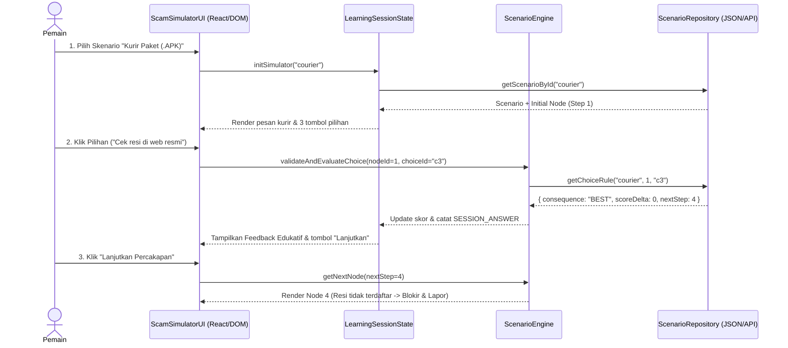

### 9.2 Sequence Diagram 2: Pemain Melakukan Investigasi Scam Detective

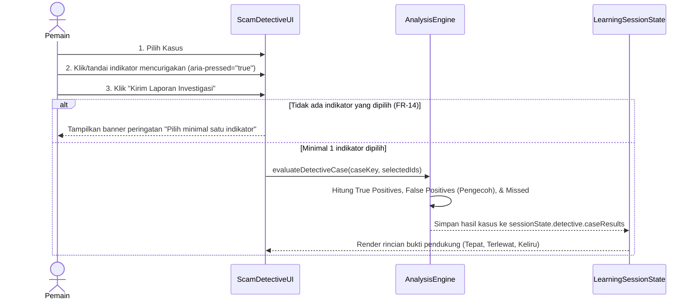

### 9.3 Sequence Diagram 3: Penyelesaian Sesi dan Pembentukan Guardian Profile

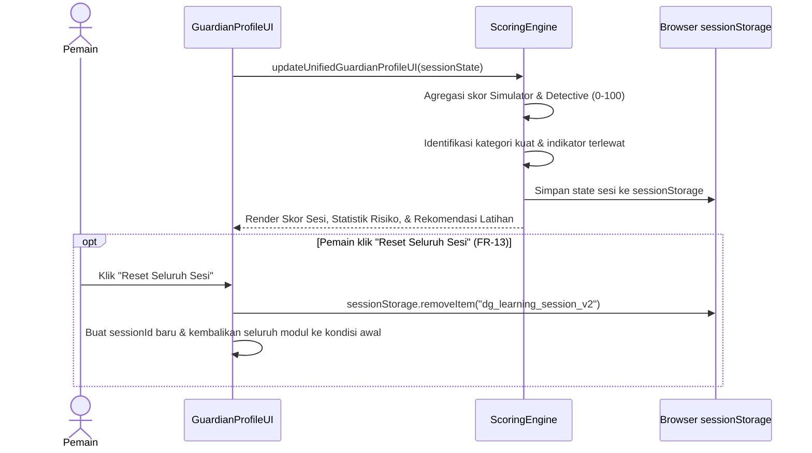

---

## BAGIAN 10 — SECURITY DAN PRIVACY DESIGN

### 10.1 Analisis Keamanan Berdasarkan Arsitektur MVP
1. **Validasi Input & Sanitasi XSS (`NFR-05`)**:
   - Seluruh input pengguna pada **Pemindai Pesan & Link (`#scanner`)** dan **Generator Draf Laporan (`#emergency-tools`)** di-*escape* menggunakan fungsi sanitasi `escapeHtml()` sebelum dirender ke DOM, mencegah *Reflected/DOM-based Cross-Site Scripting (XSS)*.
2. **Keamanan Tautan & Bukti Fiktif**:
   - Tautan berbahaya dalam skenario disajikan sebagai elemen tombol interaktif (`<button class="evidence-clue-btn">`) atau teks yang tidak pernah menavigasi browser pengguna ke domain *phishing* aktif.
3. **Minimalisasi Data & Privasi (`NFR-06`, `NFR-07`)**:
   - Sistem tidak memiliki kolom input kata sandi atau OTP nyata.
   - Teks chat WhatsApp/SMS yang ditempelkan pengguna pada modul **Pemindai Pesan (`#scanner`)** diproses 100% di memori lokal peramban (*client-side JavaScript*) dan tidak pernah dikirim ke server eksternal mana pun.
4. **Retensi Data Sesi**:
   - Data sesi disimpan di `window.sessionStorage` yang terikat hanya pada masa hidup tab peramban saat itu.
5. **Relevansi CSRF, Rate Limiting, & API Key**:
   - Karena MVP berjalan sebagai aplikasi statis tanpa autentikasi berbasis *cookie* dan tanpa pemanggilan LLM eksternal, ancaman **CSRF** dan **kebocoran API Key AI** tidak berlaku (*Not Applicable*) pada MVP. Apabila Backend API diaktifkan di masa depan, diterapkan *IP-based Rate Limiting* (misal: 60 req/menit) dan validasi skema JSON ketat.

### 10.2 Threat Model Sederhana (STRIDE Adaptation)

| Aset yang Dilindungi | Potensi Ancaman | Dampak | Strategi Mitigasi pada Desain |
| :--- | :--- | :--- | :--- |
| **Peramban Pengguna (DOM)** | **DOM-based XSS** melalui input teks bebas pada Pemindai Pesan atau Generator Laporan. | Eksekusi skrip jahat di peramban pengguna. | Sanitasi wajib dengan `escapeHtml()` / `textContent` dan penerapan header *Content Security Policy* (CSP). |
| **Privasi Teks Pesan Pengguna** | **Kebocoran Data Pribadi** saat pengguna menempelkan chat asli ke pemindai. | Informasi pribadi di dalam chat pengguna terekam pihak ketiga. | Pemrosesan heuristik dilakukan 100% secara lokal di peramban tanpa panggilan jaringan keluar. |
| **Integritas Skor Evaluasi** | **Manipulasi State Sesi (`sessionStorage` Tampering)** atau pengiriman input kosong (`FR-14`). | Skor tidak akurat atau aplikasi mengalami *crash*. | Validasi skema saat membaca `sessionStorage` dengan *fallback* otomatis ke `defaultSessionState` serta pencegahan submit kosong. |
| **Keamanan Pengguna dari Link Simulasi** | **Klik Tidak Sengaja pada URL Phishing** di dalam contoh kasus. | Pengguna mengunjungi domain berbahaya sungguhan. | Seluruh URL simulasi menggunakan elemen `<button>` non-navigasi dan domain fiktif tidak aktif. |

---

## BAGIAN 11 — DEPLOYMENT ARCHITECTURE

### 11.1 Lingkungan Development & Production
- **Development Environment**: Dijalankan secara lokal menggunakan server statis / Vite Dev Server (`http://localhost:5173` atau `python -m http.server 8080`), terintegrasi dengan Git untuk manajemen versi.
- **Production Environment**: Di-deploy ke layanan **Global Static CDN Hosting** (**Vercel** atau **Cloudflare Pages**) yang terhubung langsung ke cabang `main` repositori GitHub.
  - **Keunggulan untuk MVP**: Biaya Rp 0 (Gratis), sertifikat SSL/HTTPS otomatis, waktu muat global sangat cepat, dan bebas risiko *server/database cold-start* saat diuji oleh juri.

### 11.2 Deployment Diagram (Mermaid)

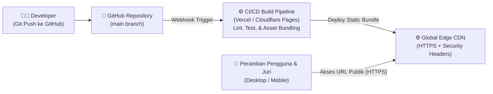

---

## BAGIAN 12 — TESTING STRATEGY DAN TEST CASES

### 12.1 Strategi Pengujian Berlapis
1. **Unit Testing**: Menguji fungsi deterministik pada mesin heuristik pemindai pesan (`analyzeMessageAndLinks`), transisi node Simulator, dan rumus penalti *Scam Detective*.
2. **Functional & Integration Testing**: Menguji keterkaitan antar-modul (misal: menyelesaikan skenario di Simulator langsung memperbarui skor dan jumlah keputusan berisiko di *Guardian Profile*).
3. **Security Testing**: Menguji input *payload* XSS (`<script>alert(1)</script>`) pada kolom Pemindai Pesan dan Generator Laporan untuk memastikan teks dirender aman sebagai string biasa.
4. **Responsive & Accessibility Testing**: Menguji tampilan pada lebar `360px`, `760px`, `1050px`, dan `1440px`, serta navigasi tombol `Tab` dan `Enter`/`Space`.

### 12.2 Tabel Test Case Utama

| Test Case ID | Modul | Skenario Pengujian | Input | Expected Result (Hasil yang Diharapkan) |
| :--- | :--- | :--- | :--- | :--- |
| **TC-01** | Scam Simulator | Pilihan simulator yang aman & cabang verifikasi | Pilih skenario Kurir APK -> Pilih opsi C (*"Cek nomor resi di situs resmi"*) | Skor tetap `100/100`, status risiko `Aman Terverifikasi`, dan percakapan bercabang ke Langkah 4 (Resi tidak terdaftar). |
| **TC-02** | Scam Simulator | Pilihan simulator yang berisiko tinggi | Pilih skenario Kurir APK -> Pilih opsi A (*"Langsung unduh Surat_Foto_Paket.apk"*) | Skor berkurang `-40` menjadi `60/100`, status risiko `Bahaya Tinggi`, percakapan bercabang ke Langkah 2 (Permintaan izin akses SMS), dan *Keputusan Berisiko* di Guardian Profile bertambah `+1`. |
| **TC-03** | Scam Detective | Menandai seluruh indikator target dengan benar tanpa pengecoh | Pilih Kasus #01 -> Klik 4 indikator bahaya (tanpa mengeklik kalimat pengecoh) -> Klik *"Kirim Laporan Investigasi"* | Skor kasus `100/100`, `Indikator Tepat: 4/4`, `Tuduhan Keliru: 0`, dan menampilkan 4 kartu penjelasan bukti pendukung. |
| **TC-04** | Scam Detective | Indikator terlewat & penalti elemen pengecoh | Pilih Kasus #01 -> Klik 2 indikator bahaya + 1 kalimat pengecoh normal -> Klik *"Kirim Laporan"* | Sistem menghitung `Indikator Tepat: 2/4`, `Tuduhan Keliru: 1 Pengecoh`, menerapkan penalti `-15`, dan menampilkan daftar *Indikator Terlewat*. |
| **TC-05** | Scam Detective | Validasi input kosong (`FR-14`) | Pastikan belum ada elemen bukti yang diklik -> Klik *"Kirim Laporan Investigasi"* | Sistem menolak evaluasi dan menampilkan banner peringatan merah: *"Pilih minimal satu bagian/indikator pada bukti di atas sebelum mengirim laporan investigasi."* |
| **TC-06** | Action Guide & Checklist | Mencetang langkah mitigasi darurat | Centang 4 langkah pada Situasi 01 | Bar progres mitigasi naik menjadi `25%` (`4 dari 16 langkah selesai`) dan tetap tersimpan saat halaman di-*refresh*. |
| **TC-07** | Guardian Profile | Pengulangan / Reset seluruh sesi (`FR-13`) | Klik tombol *"Reset Seluruh Sesi"* pada kartu Guardian Profile | `sessionStorage` dibersihkan, `sessionId` baru dibuat, skor kembali ke `-- / 100`, dan seluruh pilihan Simulator/Detective kembali ke awal. |
| **TC-08** | Scam Scanner | Memindai pesan berisi file `.apk` dan domain `.vip` + uji XSS | Masukkan teks berisi `Surat.pdf.apk`, `http://bca-tarif.vip`, dan `` -> Klik *"Analisis Risiko"* | Indeks risiko `100/100 (Bahaya Tinggi)`, menampilkan anatomi file `.apk` & domain `.vip`, serta merender tag HTML secara aman tanpa mengeksekusi skrip. |

---

## BAGIAN 13 — REQUIREMENT TRACEABILITY MATRIX (RTM)

| ID FR | Nama Kebutuhan Fungsional | Use Case Terkait | Activity Diagram | Komponen Sistem / UI | Entitas ERD / API Endpoint | Test Case ID |
| :--- | :--- | :--- | :--- | :--- | :--- | :--- |
| **FR-01** | Menampilkan Halaman Utama | UC-01 | AD-01 | `HeroSection`, `Header` | `SCENARIO` / `GET /scenarios` | TC-01 |
| **FR-02** | Memilih Mode dan Skenario | UC-02 | AD-01, AD-02 | `ScenarioSelector`, `CaseTabs` | `SCENARIO` / `GET /scenarios/:id` | TC-01, TC-03 |
| **FR-03** | Membuat Sesi Pembelajaran | UC-01, UC-02 | AD-01, AD-02 | `LearningSessionState` | `LEARNING_SESSION` / `POST /sessions` | TC-01, TC-07 |
| **FR-04** | Menampilkan Percakapan Simulasi | UC-03 | AD-01 | `ChatViewport`, `ChoicePanel` | `SCENARIO_NODE`, `CHOICE` | TC-01, TC-02 |
| **FR-05** | Memproses Pilihan Pemain (Branching) | UC-03, UC-04 | AD-01 | `ScenarioEngine` | `CHOICE`, `SESSION_ANSWER` / `POST /choices` | TC-01, TC-02 |
| **FR-06** | Mengevaluasi Keputusan Simulasi | UC-04 | AD-01 | `ScenarioEngine`, `ScoringEngine` | `CHOICE`, `SESSION_ANSWER` | TC-01, TC-02 |
| **FR-07** | Menampilkan Feedback Keputusan | UC-05 | AD-01 | `FeedbackBanner` | `CHOICE` | TC-01, TC-02 |
| **FR-08** | Menampilkan Bukti Investigasi | UC-06 | AD-02 | `EvidenceViewer` | `SCENARIO_EVIDENCE` | TC-03, TC-04 |
| **FR-09** | Mengevaluasi Indikator Risiko | UC-07, UC-08 | AD-02 | `AnalysisEngine`, `ScamScanner` | `RISK_INDICATOR`, `SCENARIO_INDICATOR`, `EVIDENCE_INDICATOR` | TC-03, TC-04, TC-08 |
| **FR-10** | Menampilkan Action Guide | UC-09 | AD-03 | `ActionGuideSection`, `EmergencyTools` | `ACTION_GUIDE`, `INDICATOR_ACTION` / `GET /action-guides` | TC-06 |
| **FR-11** | Menghitung Hasil Pembelajaran | UC-08, UC-10 | AD-04 | `ScoringEngine` | `SESSION_RESULT` / `GET /result` | TC-02, TC-03 |
| **FR-12** | Menampilkan Guardian Profile | UC-10 | AD-04 | `GuardianProfileCard` | `SESSION_RESULT` / `GET /result` | TC-03, TC-07 |
| **FR-13** | Mengulang Skenario / Reset Sesi | UC-11 | AD-01, AD-04 | `LearningSessionState` | `LEARNING_SESSION` | TC-07 |
| **FR-14** | Menangani Jawaban Tidak Valid | UC-04, UC-07 | AD-01, AD-02 | `AnalysisEngine`, `ValidationBanner` | `SESSION_ANSWER` | TC-05, TC-08 |

---

## BAGIAN 14 — REKOMENDASI TEKNOLOGI DAN TAHAPAN IMPLEMENTASI

### 14.1 Rekomendasi Stack Teknologi

| Lapisan | Teknologi yang Direkomendasikan | Alasan Pemilihan | Alternatif | Kelebihan & Kekurangan |
| :--- | :--- | :--- | :--- | :--- |
| **Frontend UI & Architecture** | **React 18 (TypeScript + Vite)** atau **Modular Vanilla ES6+ dengan Design Tokens CSS** | Cepat, mendukung pemisahan komponen UI dan *Domain Engine* deterministik tanpa *overhead* server. | Next.js / Vue 3 | (+) Sangat cepat, *bundle* kecil, mudah di-deploy.<br>(-) Tidak menggunakan SSR (tidak dibutuhkan untuk aplikasi simulasi interaktif). |
| **Styling & Design System** | **Vanilla CSS Custom Properties (`--dp-*` Software Design Tokens)** | Presisi tinggi mengikuti *Minimalist Software Design System* (`#fcfcfd`, `#16191f`, `#074ce0`), nol ketergantungan *runtime*. | Tailwind CSS | (+) Kontrol penuh atas spesifisitas, kontras, dan *reduced-motion*.<br>(-) Penulisan kelas CSS dilakukan secara eksplisit. |
| **Penyimpanan Data (MVP)** | **Structured JSON + `window.sessionStorage`** | Memenuhi batasan MVP tanpa login, 100% privasi terjaga, dan tahan terhadap *page refresh*. | IndexedDB / PostgreSQL | (+) Nol konfigurasi database, kecepatan baca instan.<br>(-) Hanya bertahan selama sesi tab peramban aktif (sesuai spesifikasi MVP). |
| **Backend & DB (Fase 2 Opsional)** | **Node.js (Fastify/Express) + PostgreSQL** | Konsisten menggunakan JavaScript/TypeScript dari ujung ke ujung; PostgreSQL mendukung tipe `JSONB` dan constraint relasional kuat. | Go + MySQL | (+) Ekosistem luas, mudah dimigrasi dari skema JSON MVP.<br>(-) Memerlukan biaya hosting server jika keluar dari *free tier*. |
| **Hosting & CI/CD** | **Vercel / Cloudflare Pages** | Deployment otomatis dari GitHub, CDN global gratis, HTTPS bawaan. | Netlify / GitHub Pages | (+) Ketersediaan tinggi, waktu *build* < 30 detik. |

### 14.2 Tahapan Implementasi yang Direkomendasikan
1. **Tahap 1 — Fondasi Design System & Kontrak Data**: Menerapkan token CSS (`--dp-*`), tipografi `Host Grotesk` & `Instrument Sans`, serta menyusun struktur data skenario Simulator, kasus Detective, dan direktori darurat.
2. **Tahap 2 — Implementasi Deterministic Engines**: Membangun logika *Heuristic Scam & Link Scanner*, *Scenario Branching Engine*, dan *Detective Evaluation Engine* beserta validasi input (`FR-14`).
3. **Tahap 3 — Integrasi Komponen Interaktif & Action Guide**: Menghubungkan *Interactive Emergency Checklist*, *Generator Draf Laporan Insiden*, *Direktori Call Center Resmi*, dan *Unified Guardian Profile* dengan persistensi `sessionStorage`.
4. **Tahap 4 — Pengujian & Publikasi**: Menguji seluruh skenario sesuai *Test Cases* (`TC-01` s.d. `TC-08`), memverifikasi responsivitas serta aksesibilitas keyboard, lalu melakukan deployment ke URL publik.
